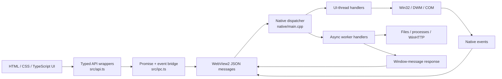
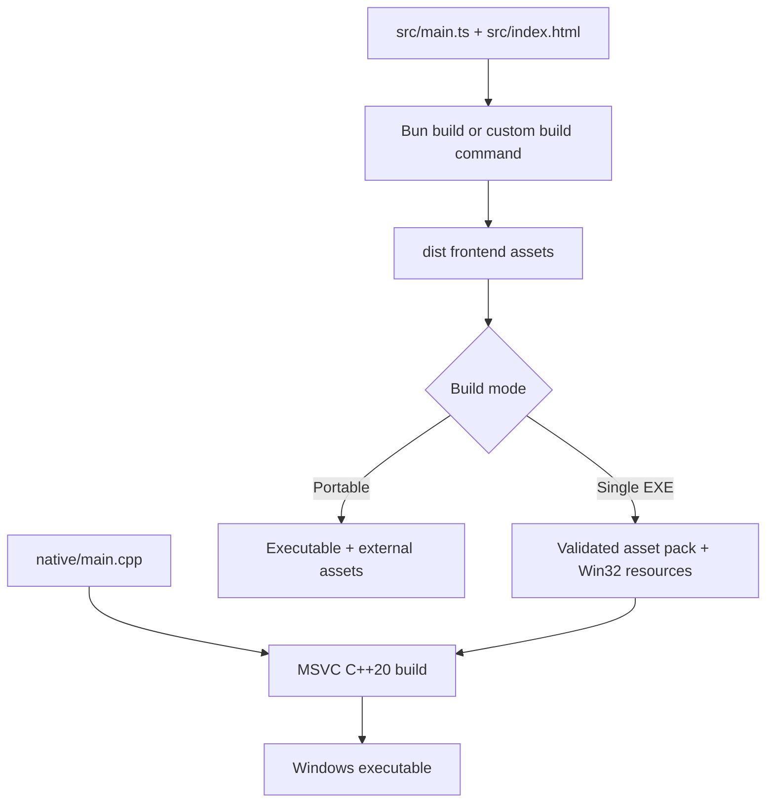

# QiangQiang Architecture

QiangQiang keeps the framework intentionally small: browser UI code talks to one native Windows shell through a typed JSON IPC boundary. The result is easy for people and coding agents to inspect without navigating a large runtime or generated binding layer.

## Runtime model



The request protocol is deliberately small:

```text
Request:  { id, cmd, args }
Response: { id, result } | { id, error }
Event:    { event, data }
```

`src/api.ts` is the public frontend contract. `native/main.cpp` is the native implementation. A public API change is complete only when both sides, tests, and documentation agree.

## Threading

- WebView2 and window operations remain on the Win32 UI thread.
- Short synchronous IPC handlers may execute on that thread.
- Network requests, captured child processes, and other blocking work use async handlers.
- Async results are posted back through a window message before calling WebView2.
- Native resources should use RAII or an equally explicit single-owner cleanup path.

## Frontend and asset loading

Development mode loads the frontend from a loopback Bun or custom dev server. Production supports:

- A portable directory containing the executable and frontend assets
- A single executable with frontend assets stored in Win32 resources and served from memory

The native shell exposes the same typed API to vanilla TypeScript, Vite, React, Vue, Svelte, Solid, or any frontend that produces browser assets.

## Build pipeline



Build and packaging logic lives in `scripts/`. The single-executable packer validates referenced local assets and archive limits before compiling resources.

## Security boundaries

The web/native IPC boundary is privileged. Important controls include:

- Command namespace permissions from `app.config.json`
- Main-WebView navigation and IPC source checks against the configured application origin
- Popup blocking so external pages cannot inherit the native bridge
- Typed wrappers and native-side input validation
- Header and argument validation for network and process APIs
- Path containment for development assets
- Timeouts and output-size limits for blocking operations
- UI-thread marshaling for WebView2 calls
- Bounded resource lifetimes and cleanup on error paths

Applications that load remote or untrusted web content should deny every native command they do not need.

## AI-friendly design

The framework is designed to reduce the context and ambiguity an AI coding agent must handle:

- One native implementation file instead of a deep native module graph
- One typed TypeScript API surface
- Predictable source and generated-directory boundaries
- Canonical check, test, and packaging commands
- Repository-wide and path-specific agent instructions
- A working example that exercises core platform behavior

See the [AI-first framework contract](AI_FIRST.md) for the design constraints and [AGENTS.md](../AGENTS.md) for the operational rules agents should follow.
